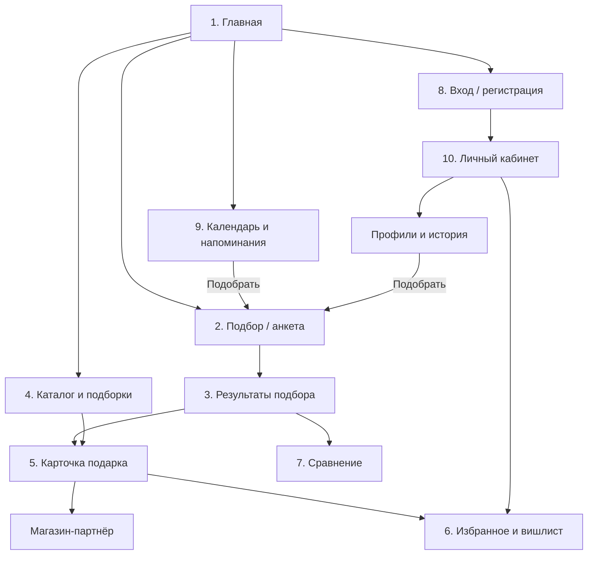

# Отчёт по самостоятельной работе №5

## «Разработка интерфейса»

**Дисциплина:** Введение в профессиональную деятельность  
**Год:** 2026  
**Город:** Рязань

---

## 1. Исходные данные

Интерфейс проектируется для сервиса по подбору подарков. Основа работы - [16 функциональных требований](https://github.com/justaise/team_vibecoders_project/blob/main/practical-works/practical-work-04/report.md#4-итоговый-перечень-функциональных-требований) и целевая аудитория из самостоятельной работы №4.

**Целевая аудитория:** люди от 12 лет, три сегмента: молодёжь (12–25), взрослые (26–55), старшее поколение (56+). Сервис должен быть удобен на смартфоне и компьютере и понятен пользователям с разным уровнем цифровых навыков.

**Главный сценарий:** быстро подобрать подходящий подарок в рамках бюджета и не забыть о важной дате.

---

## 2. Перечень экранов

Экраны определены по [функциональным требованиям (ФТ) из отчёта №4.](https://github.com/justaise/team_vibecoders_project/blob/main/practical-works/practical-work-04/report.md#4-итоговый-перечень-функциональных-требований)

| № | Экран | Назначение | Закрываемые ФТ |
|---|-------|-----------|----------------|
| 1 | Главная | Точка входа: быстрый старт подбора, поиск, готовые подборки, категории, ближайшие праздники | 5, 6, 7, 15 |
| 2 | Подбор подарка (анкета) | Ввод данных о получателе, поводе и бюджете | 1, 2, 3 |
| 3 | Результаты подбора | Список подходящих подарков, фильтры, в том числе по срокам доставки | 4, 11 |
| 4 | Каталог и подборки | Просмотр подарков по категориям (включая впечатления), поиск, готовые подборки | 5, 6, 7 |
| 5 | Карточка подарка | Фото, описание, цена, оценка и отзывы, переход в магазин, добавление в избранное и сравнение | 8, 9 |
| 6 | Избранное и вишлист | Сохранённые подарки, список для публикации по ссылке | 13 |
| 7 | Сравнение подарков | Таблица характеристик нескольких выбранных подарков | 10 |
| 8 | Вход / регистрация | Создание аккаунта и вход | 12 |
| 9 | Календарь и напоминания | Праздники и дни рождения, настройка напоминаний | 15 |
| 10 | Личный кабинет | Профили получателей и история подаренного | 14, 16 |

Все 16 требований охвачены хотя бы одним экраном. Внешний сайт магазина-партнёра в перечень не входит: это переход за пределы сервиса (ФТ 9).

---

## 3. Состав элементов основных экранов

### 3.1. Главная

| Элемент | Назначение |
|---------|-----------|
| Шапка: логотип, меню (Подбор, Каталог, Календарь, Избранное), кнопки «Войти» и «Регистрация» | Навигация по сервису, доступна на всех экранах |
| Заголовок и подзаголовок | Объясняют, что делает сервис |
| Кнопка «Подобрать подарок» | Главное действие, ведёт к анкете |
| Поле поиска | Быстрый поиск по ключевым словам |
| Блок «Готовые подборки» | Быстрый вариант без анкеты |
| Блок «Категории» (чипы) | Переход в каталог по категории |
| Блок «Ближайшие праздники» с кнопкой «Подобрать» | Напоминание о датах и сразу переход к подбору |

### 3.2. Подбор подарка (анкета)

| Элемент | Назначение |
|---------|-----------|
| Индикатор шагов «Получатель - Повод - Бюджет» | Показывает прогресс |
| Выбор типа отношений (друг, коллега, родитель, партнёр, начальник) | Учёт отношений с получателем |
| Выбор пола и поле возраста | Данные о получателе |
| Теги интересов | Выбор нескольких интересов одним касанием |
| Выпадающий список «Повод» | Выбор повода |
| Двойной ползунок бюджета | Задание диапазона «от и до» |
| Кнопки «Сбросить» и «Подобрать подарки» | Очистка формы и запуск подбора |

### 3.3. Результаты подбора

| Элемент | Назначение |
|---------|-----------|
| Строка с введёнными параметрами | Напоминает, по каким данным показан результат |
| Панель фильтров: бюджет, категория, срок доставки («Срочно», до 3 и до 7 дней) | Уточнение выдачи |
| Карточки подарков: фото, название, цена, оценка | Краткая информация для выбора |
| Значок «♡» | Добавить в избранное |
| Флажок «сравнить» и панель «Выбрано для сравнения» | Выбор подарков для таблицы сравнения |

### 3.4. Карточка подарка

| Элемент | Назначение |
|---------|-----------|
| Фото и галерея | Визуальное представление подарка |
| Название, оценка, количество отзывов, цена | Основные сведения |
| Описание и сроки доставки | Помогают принять решение |
| Кнопка «Купить в магазине» | Переход на сайт магазина-партнёра |
| Кнопки «В избранное» и «Сравнить» | Сохранение и сравнение |
| Блок отзывов | Повышает доверие к рекомендации |

### 3.5. Избранное и вишлист

| Элемент | Назначение |
|---------|-----------|
| Вкладки «Избранное» и «Вишлист» | Переключение между списками |
| Список подарков с кнопками «Открыть» и «✕» | Возврат к подарку, удаление из списка |
| Блок «Поделиться вишлистом»: ссылка и кнопка «Копировать ссылку» | Передача списка другим людям |

### 3.6. Календарь и напоминания

| Элемент | Назначение |
|---------|-----------|
| Список событий: дата, название, получатель | Обзор ближайших праздников |
| Переключатель «Напомнить за N дней» | Включение напоминания |
| Кнопка «Подобрать» у события | Переход к анкете с подставленными данными |
| Кнопка «Добавить событие» | Добавление собственной даты |

### 3.7. Личный кабинет

| Элемент | Назначение |
|---------|-----------|
| Вкладки «Профили получателей», «История подаренного», «Мои данные» | Разделы кабинета |
| Карточки получателей: имя, возраст, интересы | Сохранённые данные о людях |
| Кнопки «Подобрать» и «Изменить» | Повторный подбор по профилю, редактирование |
| Кнопка «Добавить получателя» | Создание нового профиля |
| Блок «Недавно подарено» | Чтобы не дарить одно и то же дважды |

---

## 4. Навигация между экранами

Верхнее меню доступно на каждом экране, логотип всегда ведёт на главную.

| Откуда | Куда | Действие |
|--------|------|---------|
| Главная | Подбор | Кнопка «Подобрать подарок» |
| Главная | Каталог | Категория, подборка, поиск |
| Главная | Календарь | Блок «Ближайшие праздники», пункт меню |
| Главная | Вход / регистрация | Кнопки в шапке |
| Подбор | Результаты | Кнопка «Подобрать подарки» |
| Результаты | Карточка подарка | Нажатие на карточку |
| Результаты | Сравнение | Кнопка «Сравнить» (выбрано 2 и более подарков) |
| Каталог | Карточка подарка | Нажатие на карточку |
| Карточка | Магазин-партнёр | Кнопка «Купить в магазине» |
| Карточка | Избранное | Кнопка «В избранное» |
| Календарь, Профили получателей | Подбор | Кнопка «Подобрать» (данные подставляются) |
| Вход / регистрация | Личный кабинет | После успешного входа |
| Личный кабинет | Избранное, Календарь | Пункты меню |

Главный сценарий проходит за три шага: **Главная → Подбор → Результаты**, затем карточка и переход в магазин.

### Карта навигации

Та же схема в виде диаграммы:

---

## 5. Эскизы основных экранов

Эскизы выполнены в виде каркасов (wireframes) для десктопной версии. 

### 5.1. Главная

### 5.2. Подбор подарка (анкета)

### 5.3. Результаты подбора

### 5.4. Карточка подарка

### 5.5. Избранное и вишлист

### 5.6. Календарь и напоминания

### 5.7. Личный кабинет

---

## 6. Обоснование решений с опорой на целевую аудиторию

| Решение | Обоснование |
|---------|-------------|
| Главное действие «Подобрать подарок» выделено цветом и размером | Основная потребность всех сегментов - «не знаю, что подарить» и «нет времени на поиск». Пользователь сразу видит, с чего начать |
| Подбор по анкете и параллельные пути (подборки, каталог, поиск) | Те, кто не хочет заполнять анкету, находят подарок быстрее другим путём |
| Анкета на одном экране с индикатором шагов, выбор через теги и ползунок | Меньше набора текста: удобно на смартфоне и молодёжи, и тем, у кого невысокие цифровые навыки |
| Крупные кнопки и шрифт, высокий контраст, подписи у всех значков | Для старшего поколения (56+): не нужно угадывать значение иконок, элементы легко нажимать |
| Простые русские формулировки («Купить в магазине», «Подобрать», «Сравнить») | Понятны подросткам и пользователям старшего возраста без пояснений |
| Бюджет вынесен в анкету и в фильтры | Бюджет - главное ограничение для взрослых и молодёжи (ФТ 3) |
| Фильтр «Срочно (сегодня)» | Закрывает ситуацию «подарок нужен срочно» (ФТ 11) |
| Отзывы и оценки на карточке, сравнение в таблице | Снижают страх выбрать неудачный подарок |
| Кнопка «Подобрать» в календаре и в профилях получателей | Короткий путь от напоминания к подбору, данные подставляются автоматически |
| Работа без регистрации: подбор, каталог и карточки доступны гостю | Регистрация нужна только для сохранения данных (ФТ 12-16), поэтому не отпугивает новых пользователей |
| Единая шапка и верхнее меню на всех экранах | Пользователь не теряется, до любого раздела - одно нажатие |
| Не более 3 шагов до результата | Соответствует цели «сократить время на выбор» |

---

## 7. Вывод

На основе 16 функциональных требований из самостоятельной работы №4 определено 10 экранов сервиса по подбору подарков. Для основных экранов описан состав элементов и их назначение, продумана навигация (таблица переходов и карта), создано 7 эскизов экранов.

Интерфейс построен вокруг главного сценария: Главная → Подбор → Результаты → Карточка → Магазин-партнёр. Каждое требование отражено хотя бы в одном экране. Решения учитывают разный возраст и цифровые навыки аудитории: крупные элементы, понятные подписи, минимум ввода текста и короткий путь к результату. Дополнительные функции (избранное, календарь, профили) вынесены в отдельные разделы и не усложняют основной сценарий.
